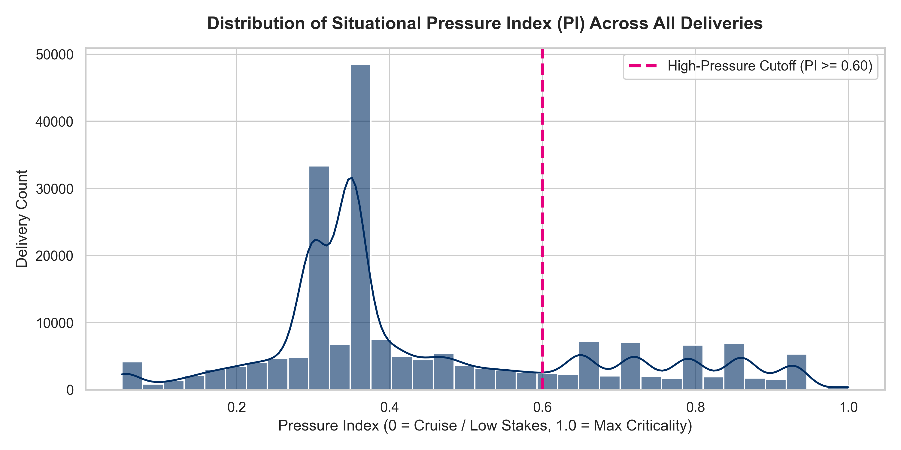
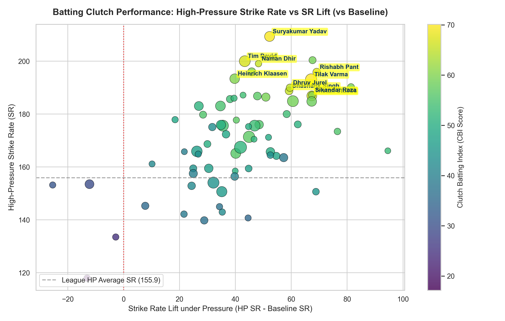
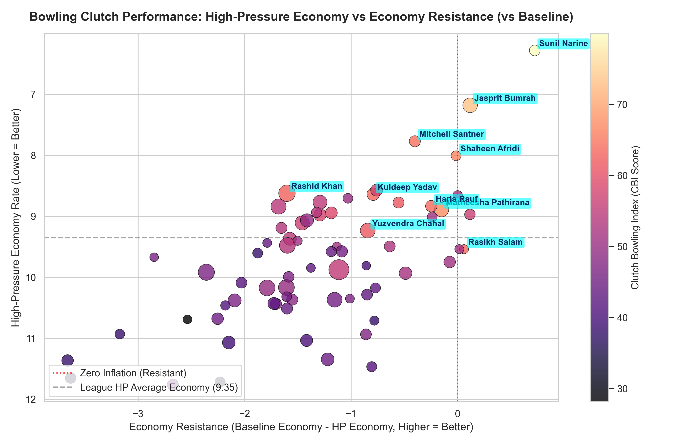
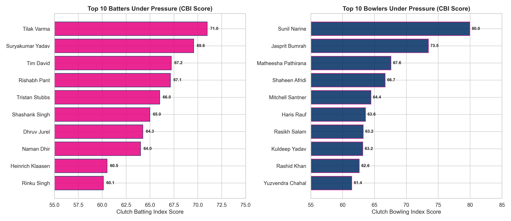

# SupeRR Selector Season 2: Identify the Most Reliable Players Under Pressure
> **Rajasthan Royals Hackathon — Quantitative Player Evaluation Engine**  
> *Developed with ball-by-ball T20 and IPL historical data (2022–2026).*

[](https://www.python.org/downloads/)
[](https://opensource.org/licenses/MIT)
[](https://www.rajasthanroyals.com/)

---

## 📌 Executive Summary

T20 cricket matches are won and lost in moments of intense stress: mounting required run rates, early collapses, and overs 16–20 death-phase execution. Conventional cricket metrics (cumulative runs, overall strike rate, and nominal economy) fail to capture who reliably delivers when the game is on the line.

This repository implements the **Rajasthan Royals Situational Pressure & Clutch Index (CBI)**. By reconstructing the exact match state space across **883 matches (200,999 deliveries)** from 2022 to 2026 across IPL and T20 Internationals, our system quantifies delivery-level pressure ($PI \in [0, 1]$) and evaluates how players perform in high-pressure match situations ($PI \ge 0.60$) compared with their usual performance baselines.

Crucially, our framework incorporates **Hazard-Preserved Baseline Normalization**: recognizing that the entire league experiences an average drop of -32.6% in batting average under pressure, it eliminates the artificial penalty on pure finishers whose baselines are inflated by 'not-outs' in easy games.

---

## 🏆 Final Official Top 10 Rankings

### Top 10 Batters Under Pressure
| Rank | Player Name | Player ID | CBI Score | HP Balls | HP Runs | HP SR | Base SR | SR Lift ($\Delta$) | HP Avg | Consistency Rate |
|:---:|:---|:---:|:---:|:---:|:---:|:---:|:---:|:---:|:---:|:---:|
| **1** | **Namboori Tilak Varma** | `7897` | **70.99** | 637 | 1,230 | 193.09 | 125.98 | **+67.11** | 42.41 | **80.0%** |
| **2** | **Suryakumar Yadav** | `1699` | **69.58** | 492 | 1,030 | 209.35 | 157.12 | **+52.23** | 38.15 | **83.3%** |
| **3** | **Tim David** | `6396` | **67.24** | 594 | 1,188 | 200.00 | 156.65 | **+43.35** | 34.94 | **87.2%** |
| **4** | **Rishabh Pant** | `4703` | **67.13** | 292 | 572 | 195.89 | 126.79 | **+69.10** | 30.11 | **94.4%** |
| **5** | **Tristan Stubbs** | `20702` | **66.02** | 488 | 912 | 186.89 | 119.53 | **+67.36** | 38.00 | **72.4%** |
| **6** | **Shashank Singh** | `2756` | **64.99** | 303 | 572 | 188.78 | 129.57 | **+59.21** | 44.00 | **70.0%** |
| **7** | **Dhruv Jurel** | `7260` | **64.25** | 279 | 530 | 189.96 | 130.44 | **+59.52** | 35.33 | **81.3%** |
| **8** | **Naman Dhir** | `37052` | **64.01** | 215 | 428 | 199.07 | 150.80 | **+48.27** | 30.57 | **93.8%** |
| **9** | **Heinrich Klaasen** | `4260` | **60.51** | 468 | 905 | 193.38 | 153.64 | **+39.74** | 30.17 | **81.8%** |
| **10** | **Rinku Singh** | `4708` | **60.12** | 602 | 1,113 | 184.88 | 124.30 | **+60.58** | 30.92 | **70.2%** |

---

### Top 10 Bowlers Under Pressure
| Rank | Player Name | Player ID | CBI Score | HP Legal Balls | HP Wkts | HP Econ | Base Econ | Resistance ($\Delta$) | Balls/Wkt | Consistency Rate |
|:---:|:---|:---:|:---:|:---:|:---:|:---:|:---:|:---:|:---:|:---:|
| **1** | **Sunil Narine** | `781` | **79.95** | 299 | 26 | **6.28** | 7.01 | **+0.73** | 11.50 | **83.3%** |
| **2** | **Jasprit Bumrah** | `2933` | **73.46** | 554 | 43 | **7.18** | 7.30 | **+0.12** | 12.88 | **74.1%** |
| **3** | **Matheesha Pathirana** | `8661` | **67.58** | 529 | 49 | **8.89** | 8.74 | **-0.15** | 10.80 | **69.4%** |
| **4** | **Shaheen Afridi** | `6355` | **66.67** | 254 | 26 | **8.01** | 7.99 | **-0.01** | 9.77 | **69.0%** |
| **5** | **Mitchell Santner** | `4101` | **64.45** | 322 | 23 | **7.77** | 7.37 | **-0.40** | 14.00 | **71.4%** |
| **6** | **Haris Rauf** | `7364` | **63.59** | 343 | 36 | **8.83** | 8.59 | **-0.25** | 9.53 | **58.8%** |
| **7** | **Rasikh Salam** | `7327` | **63.23** | 217 | 26 | **9.54** | 9.60 | **+0.06** | 8.35 | **61.1%** |
| **8** | **Kuldeep Yadav** | `3644` | **63.16** | 407 | 36 | **8.64** | 7.85 | **-0.79** | 11.31 | **66.7%** |
| **9** | **Rashid Khan** | `4722` | **62.62** | 707 | 62 | **8.62** | 7.02 | **-1.60** | 11.40 | **63.5%** |
| **10** | **Yuzvendra Chahal** | `1612` | **61.44** | 575 | 53 | **9.23** | 8.39 | **-0.84** | 10.85 | **55.4%** |

---

## 📊 Analytical Visualizations

| Figure | Description |
|:---:|:---|
|  | **Distribution of Pressure Index (PI)** across 200,999 balls, highlighting the operational threshold ($PI \ge 0.60$). |
|  | **Batting Clutch Matrix**: High-Pressure Strike Rate vs Strike Rate Lift ($\Delta SR$) over baseline. |
|  | **Bowling Clutch Matrix**: High-Pressure Economy vs Economy Resistance ($\Delta ER$) over baseline. |
|  | **Top 10 Batters and Bowlers Infographic** by standardized Clutch Index Score. |

---

## ⚙️ Mathematical Model & Architecture

### 1. Delivery-Level Situational Pressure Index ($PI \in [0, 1]$)
- **Innings 2 (The Chase)**:
  $$PI_{inn2} = \left(0.50 \cdot S_{RRR}(t) + 0.25 \cdot S_{W}(t) + 0.25 \cdot S_{Late}(t)\right) \times A(t) \times M_{stakes}$$
  - $S_{RRR}(t) = \frac{1}{1 + e^{-0.5 \cdot (\text{RRR}_t - 9.5)}}$ (Logistic stress function centered at par 9.5 RPO).
  - $S_W(t) = \frac{10 - \text{Wickets in Hand}}{10}$ (Resource depletion penalty).
  - $S_{Late}(t) = 1 - \frac{\text{Balls Remaining}}{120}$ (Outcome leverage sensitivity).
  - $A(t)$: Contest viability filter downweighting dead-rubbers.
  - $M_{stakes} = 1.15$ for Knockout stages (Finals, Semi-Finals, Qualifiers, Eliminators).

- **Innings 1 (Target Setting)**:
  $$PI_{inn1} = \max\left(P_{phase}(t), 0.30 + 0.50 \cdot \text{Crisis}(t)\right) \times M_{stakes}$$
  - $\text{Crisis}(t) = \max\left(0, \frac{\text{Wickets Lost} - 7.0 \cdot (b/120)^{0.7}}{4.0}\right)$
  - $P_{phase}(t) = 0.65 + 0.07 \cdot (\text{Over} - 16)$ for Overs 16–20.

- **Super Overs**: Fixed maximum pressure ($PI = 1.0$).

### 2. Standardized Clutch Index (CBI)
$$\text{CBI} = 50 + 15 \cdot \left(0.35 \cdot \mathcal{S}_{abs} + 0.30 \cdot \mathcal{S}_{lift} + 0.20 \cdot \mathcal{S}_{cons} + 0.15 \cdot \mathcal{S}_{vol}\right)$$
- **$\mathcal{S}_{abs}$ (35%)**: Absolute pressure performance (SR, Average, Dot% for batters; Economy, Balls/Wicket, Dot% for bowlers).
- **$\mathcal{S}_{lift}$ (30%)**: Performance delta vs player's own normal baseline ($\Delta SR$, Hazard-preserved Average, Economy Resistance $\Delta ER$).
- **$\mathcal{S}_{cons}$ (20%)**: Match-by-match reliability rate in pressure situations.
- **$\mathcal{S}_{vol}$ (15%)**: Bayesian shrinkage confidence and opponent tier weighting ($1.0$ for elite franchise/top-9 Full Members; $0.85$ for emerging).

---

## 📁 Repository Structure

```
├── README.md                                  # Complete project documentation
├── .gitignore                                 # Git ignore patterns
├── run_model.py                               # End-to-end analytical pipeline
├── generate_report.py                         # Report & visual compilation script
├── Methodology_Report_SupeRR_Selector.pdf     # Official 6-page submission PDF
├── Methodology_Report_SupeRR_Selector.html    # Interactive styled HTML report
├── Methodology_Report_SupeRR_Selector.md      # Detailed methodology document
├── Round 1 Problem Statement...pdf            # Rajasthan Royals competition brief
├── top_10_batters.csv                         # Final ranked Top 10 Batters
├── top_10_bowlers.csv                         # Final ranked Top 10 Bowlers
├── all_batters_metrics.csv                    # Complete metrics for all qualified batters
├── all_bowlers_metrics.csv                    # Complete metrics for all qualified bowlers
├── fig1_pressure_distribution.png             # Pressure Index distribution plot
├── fig2_batting_clutch_matrix.png             # Batting clutch scatter matrix
├── fig3_bowling_clutch_matrix.png             # Bowling clutch scatter matrix
├── fig4_top10_rankings_summary.png            # Summary leaderboard infographic
├── ball_by_ball.csv                           # Granular delivery records (200k+ balls)
├── matches.csv                                # Match results and conditions
├── competitions.csv                           # Tournament and season metadata
├── teams.csv                                  # Team identifiers and mappings
├── playing_eleven.csv                         # Playing XI team sheets
└── competition_team_player_mapping.csv        # Player ID and name resolution map
```

---

## 🚀 How to Reproduce

1. **Clone repository**:
   ```bash
   git clone https://github.com/amangupta982/SuperRR-Hackathon.git
   cd SuperRR-Hackathon
   ```

2. **Run analytical model**:
   ```bash
   python3 run_model.py
   ```

3. **Re-compile methodology report**:
   ```bash
   python3 generate_report.py
   ```

---

## 🏏 License & Acknowledgements
- Developed for **Rajasthan Royals SupeRR Selector Season 2**.
- Open-sourced under the [MIT License](LICENSE).
